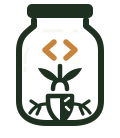

<p align="center">
  
</p>

<h1 align="center">vibevarium</h1>

<p align="center">
  <em>the self-hostable home for your internal apps.</em>
</p>

<p align="center">
  Open-source infrastructure you run yourself — not a hosted product.<br/>
  Every app gets its own repo, its own deploy, its own auth, all raised<br/>
  from one control plane in <em>your</em> cloud. Your garden, your rules.
</p>

<p align="center">
  <a href="./docs/setup.md"><strong>Self-hosting guide</strong></a> ·
  <a href="./docs/customization.md">Customization</a> ·
  <a href="https://vibevarium.com">vibevarium.com</a>
</p>

---

## What grows here

One command (or one click) scaffolds a new app into the world: GitHub repo,
Cloudflare Worker + D1 deploy, custom domain, registered OIDC client, and
automatic discovery by the platform. Apps are grown from a single template —
React SPA + typed Effect backend — so the contract never varies, only the
starting shape.

- **Control plane** (`platform.$TERRARIUM_DOMAIN`) — provision, inspect, and
  prune apps; the meta-MCP aggregates every app's tools into one gateway.
- **Auth** — OIDC-only boundary; one platform token opens the gateway and
  every app, with per-app grants revocable in the control plane. Swap the
  provider (Casdoor, WorkOS, your SSO) with config, not code.
- **CLI** — the `vibevarium` binary composes app CLIs (and dynamically imports
  MCP tool schemas) so agents and humans share one interface.
- **Connections** — connect a provider (GitHub, Linear, …) once, vend per-app
  tokens through a unified credential-holding proxy, revoke with a cascade.

## Run your own

There is no vibevarium cloud. The software is the product: fork the repo,
bring your own AWS + Cloudflare + GitHub, and deploy.

- **[docs/setup.md](./docs/setup.md)** — three paths: local dev
  (zero-infrastructure, emulators prove every flow), AWS production (EC2 + RDS
  + Secrets Manager, one `deploy.sh`), and an experimental Cloudflare-hosted
  control plane.
- **[docs/customization.md](./docs/customization.md)** — the domain knob,
  auth-provider swaps, connections, secrets, theming, templates.

## Brand

The design system is **botanical print**: a field guide to your garden.
Fraunces serif display over Source Sans 3, squared letterpress edges,
hairline + double rules, laid-paper grain — in the **Vellum** (light) /
**Graphite** (dark) palette pair, WCAG-audited to AA/AAA.

The brand spec lives in [assets/branding/BRAND.md](./assets/branding/BRAND.md);
the mark is a glass apothecary jar whose sprout leaves are `</>` — see
`@vibevarium/ui`'s `Logo` / `LogoLockup` components and
[assets/branding/logo.svg](./assets/branding/logo.svg).

## Layout

```
apps/                  grown + in-progress app instances
packages/
  control-plane/       the gardener: provisioning, registry, gateway, MCP
  template-cloudflare/ the starter seed every app grows from
  ui/                  design system (botanical-print theme, components)
  cli/                 the vibevarium binary
  infra/               AWS infrastructure (Alchemy)
  auth, connections/   platform services
docs/                  public guides (setup, customization)
docs/internal/         working notes (git-ignored — stays local, not public)
assets/branding/       the brand spec + logo (tracked, public)
```
